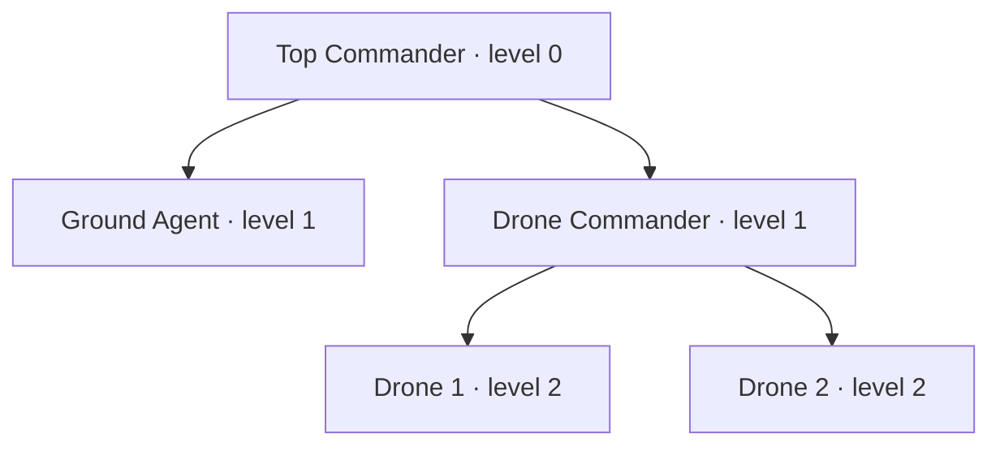

# Hierarchy Data Model (FALCON-053)

How the command chain is represented per agent. This is the data contract the
hierarchy tickets (054–059) and the parameterized harness (066–071) implement
against. Related fields are in [state.md](state.md); the role states are in
[role-state-machine.md](role-state-machine.md).

## Per-agent hierarchy fields

| Field | Type | Meaning |
| --- | --- | --- |
| `parent_id` | agent id \| null | The agent's commander. `null` only at the current top. |
| `follower_ids` | list[agent id] | The agent's direct followers (its children). Empty for a leaf. |
| `hierarchy_level` | int ≥ 0 | Distance from the current top: `0` at the top, otherwise `parent level + 1`. **Log-only** (see below). |
| `current_role` | `COMMANDER` \| `FOLLOWER` | The agent's role; a middle agent is both, per direction. |
| `role_epoch` | int ≥ 0 | Authority version the agent recognizes; increments on each handover. |
| `scope` | agent id | The subtree an agent commands — identified by the commander's id. One commander per scope. |

## Chain structure

The hierarchy is a **chain**: exactly one commander per level, arbitrary depth.
A middle agent is a follower to its parent and a commander to its children. The
sponsor's concrete case:

The Ground Agent and Drone Commander are followers to the Top Commander and
commanders to their own subgroups. The Top Commander talks only to the Drone
Commander, never directly to individual drones.

## `hierarchy_level` is log-only

`hierarchy_level = parent level + 1` (0 at the top). It is held in state for
computation and written to the logs, but it is **never** placed on the wire
envelope or in a status snapshot — the JSON Schema rejects it there
(see [protocol.md](protocol.md)). It is recalculated automatically whenever the
structure changes. A **skip-level insertion** is the key case: when a new top is
granted the role, the previous top shifts from level `0` to `1` and every agent
below it shifts down one level. Resolving a received message's level uses the
sender's level from the known-peers table; an unknown sender yields `null`.

## Integrity rules (validated in FALCON-059)

- No circular hierarchy (an agent cannot be its own ancestor).
- Each agent has exactly one parent, except the top (`parent_id = null`).
- Exactly one commander per scope.
- `hierarchy_level` is always `parent level + 1`, recomputed on every structure
  change.
