# Role State Machine (FALCON-044)

The states an agent's authority passes through, and the legal transitions
between them. This is the contract the Role Manager and the role-switching
tickets (045–051) and failover tickets (060–065) implement against. Role
messages are defined in [vocabulary.md](vocabulary.md#role-management); the
`role_epoch` field is in [protocol.md](protocol.md).

Role values are written here exactly as they appear in the schema and code:
lowercase `commander` and `follower` (the `sender_role` / `current_role` enum).
`transitioning` is a transient internal status, not a value carried on the wire.

## States

| State | Meaning |
| --- | --- |
| `follower` | The agent obeys a commander. Default state for every agent at startup. |
| `commander` | The agent issues commands to its followers and is the authority for its scope. |
| `transitioning` | A handover is in progress: the agent has requested a role, or is being promoted, and the outcome is not yet settled. No commands are issued or obeyed as authority until it resolves. Internal only — never sent as `current_role`. |

`current_role` in the follower state model holds `commander` or `follower`
(see [state.md](state.md)); `transitioning` is a transient status during a
handover, not a resting value.

## Dual-role agents

Every agent carries both a Commander module and a Follower module. A **middle
agent** is a `follower` upward (to its parent) and a `commander` downward (to its
own followers) **at the same time**. The state machine below describes a single
authority relationship; a middle agent runs one instance per direction. Only the
active module for a given direction processes messages.

## Legal transitions

```mermaid
stateDiagram-v2
    [*] --> follower
    follower --> transitioning: send REQUEST_ROLE / selected to self-promote
    transitioning --> commander: GRANT_ROLE received / self-promotion succeeds (role_epoch++)
    transitioning --> follower: DENY_ROLE received / live re-check fails
    commander --> follower: step down (revived or graceful handover; adopt newer role_epoch)
```

| From | To | Trigger | Epoch |
| --- | --- | --- | --- |
| `follower` | `transitioning` | The agent sends `REQUEST_ROLE` (possibly skip-level), or the deterministic failover rule selects it to self-promote. | unchanged |
| `transitioning` | `commander` | A `GRANT_ROLE` is received, or self-promotion passes its live re-check. | **increments** |
| `transitioning` | `follower` | A `DENY_ROLE` is received, or the self-promotion live re-check fails (role cascades to the next agent in ID order). | unchanged |
| `commander` | `follower` | The agent steps down: a revived commander sees a higher `role_epoch`, or a graceful handover yields authority. It adopts the newer epoch. | adopts newer |

## Rules

- **No direct `follower` → `commander`.** Every promotion passes through
  `transitioning`, so a half-finished handover is never mistaken for authority.
- **`role_epoch` increments only on a successful promotion** (grant or
  self-promotion) — never on a deny or a failed re-check.
- **Only the current top commander may grant a role request.** A grant makes the
  requester the new top (the previous hierarchy nests one level deeper), so the
  grantor must itself hold top authority — it cannot confer authority it does not
  have. A commander that is **not** the top replies `DENY_ROLE` with reason
  `not_authorized`. A request may still be *addressed* to any commander above
  (skip-level), but only the top grants it. *(Adopted v1 rule; see the design
  note below.)*
- **A revived commander never reclaims the role automatically.** It rejoins as a
  `follower`; the only way back is a later deliberate graceful handshake.
- **Stale or unauthorized role messages cause no transition** — they are
  rejected (see [protocol-errors.md](protocol-errors.md)) and logged.
- **Exactly one `commander` per scope.** Enforced during handover (FALCON-050).

## Design note — who may grant (skip-level)

The master plan says a request "may target any commander above" and that, on
grant, "the requester becomes a new top and the previous hierarchy nests one
level deeper." Those two statements are only consistent if the **grant** comes
from the current top: an agent cannot hand out authority above itself. v1
therefore adopts **top-only granting** — any non-top commander that receives a
request denies it with `not_authorized`. This keeps authority sound and prevents
a mid-level commander from minting a new top. Forwarding a request up the chain
(instead of denying) is a possible future refinement, out of scope for v1.
